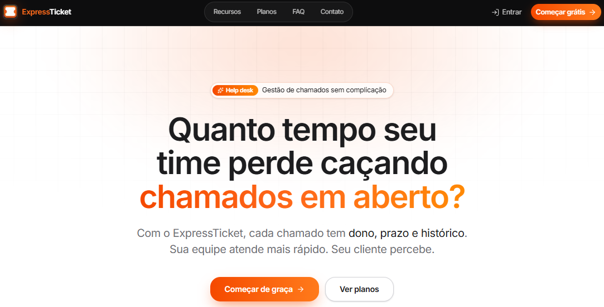
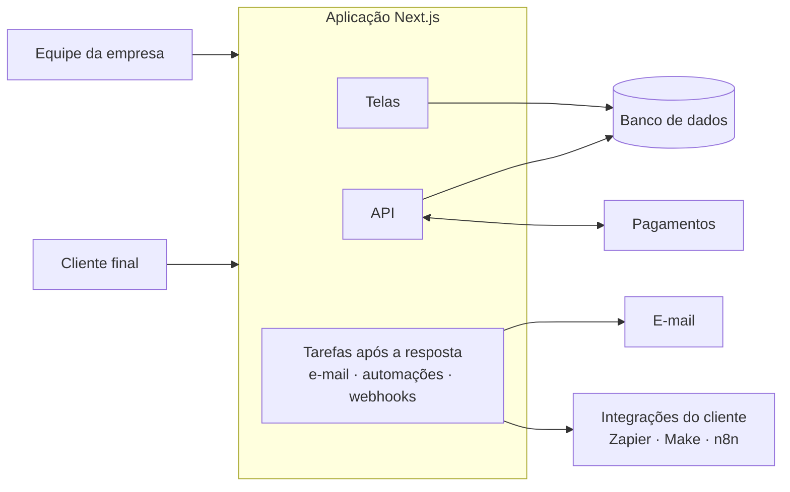
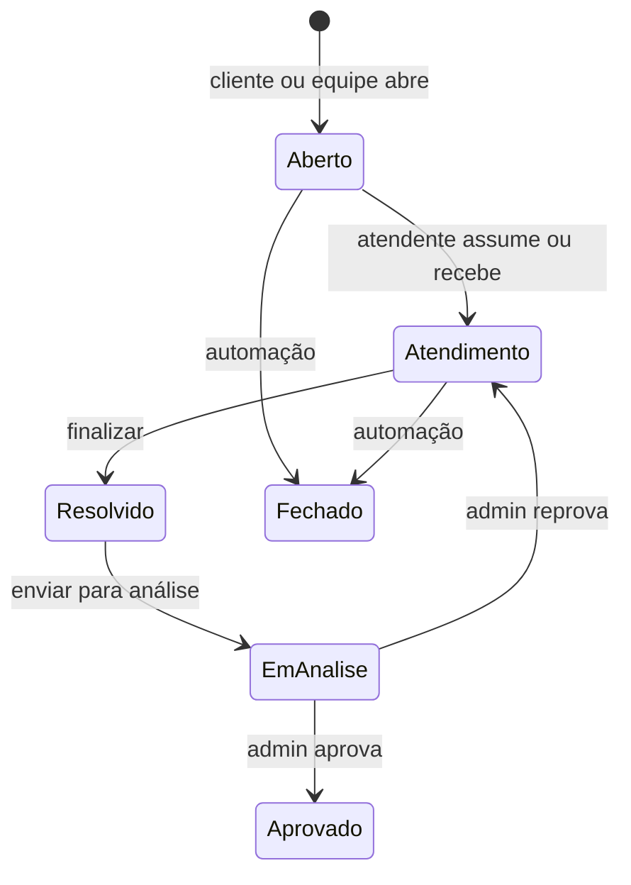

# Express Ticket: Help Desk SaaS

**Estudo de caso de um SaaS multi-tenant de gestão de chamados, do zero à produção**

[**expressticket.com.br**](https://www.expressticket.com.br) · Desenvolvedor solo · 2026

> Um help desk em português, com preço em reais, para pequenas e médias empresas que atendem clientes por chamado: Kanban, SLA, portal com a marca da empresa para o cliente final, automações e relatórios. Tudo isolado por empresa e cobrado por assinatura.

---

## Índice

- [O problema](#o-problema)
- [A solução](#a-solução)
- [Arquitetura](#arquitetura)
- [Desafios: problema, decisão e trade-off](#desafios-problema-decisão-e-trade-off)
- [Resultados](#resultados)
- [O que aprendi](#o-que-aprendi)
- [Autor](#autor)

---

## O problema

Pequenas empresas brasileiras que prestam suporte costumam ficar entre duas opções ruins:

- **Ferramentas globais** (Zendesk, Freshdesk): interface e documentação em inglês, preço em dólar e uma curva de configuração pensada para times grandes.
- **Improviso**: WhatsApp, e-mail e planilha. Sem SLA, sem histórico por cliente, sem saber quem está atendendo o quê.

Faltava algo no meio: simples de começar no mesmo dia, em português, com preço em real e que crescesse junto com o time.

## A solução

O **Express Ticket** é um SaaS B2B em que cada empresa assinante ganha um ambiente isolado com três papéis:

| Papel           | Quem é                    | Como entra                                     |
| --------------- | ------------------------- | ---------------------------------------------- |
| **Admin**       | Dono ou gestor do suporte | Usuário e senha                                |
| **Atendente**   | Equipe de suporte         | Usuário e senha, com permissões definidas pelo admin |
| **Cliente**     | Cliente final da empresa  | Conta Google, pelo portal da empresa           |

O fluxo para a empresa:

1. **Se cadastra em 3 etapas** e ganha 7 dias de teste de um plano pago, sem cartão.
2. **Configura o catálogo** (departamentos e categorias) e convida os atendentes.
3. **Divulga o portal** com a própria marca (logo e cores). O cliente entra com Google e abre chamados.
4. **Atende pelo Kanban**, com SLA visível em cada card, e acompanha tudo em relatórios.
5. **Automatiza** respostas, prioridade, escalonamento e integrações via webhook.
6. **Assina e gerencia o plano** sozinha, com cartão ou boleto, e compra licenças avulsas de atendente quando precisa.

### Principais funcionalidades

- **Atendimento**: Kanban com ações no próprio card, SLA por chamado, histórico com autor de cada ação, alerta sonoro e paleta de comandos.
- **Gestão**: permissões individuais por atendente, clientes com vários e-mails autorizados, catálogo próprio e portal white-label.
- **Automação**: gatilhos (chamado criado, palavra-chave, chamado parado, SLA perto de vencer, agendado) e ações (resposta automática, fechar, prioridade, status, escalar, webhook assinado).
- **Relatórios**: de KPIs básicos até SLA cumprido, desempenho por atendente, comparação com o período anterior e exportação CSV/PDF, conforme o plano.
- **Experiência**: cadastro em etapas, recuperação de senha, foto de perfil, central de ajuda e um mascote (panda) nos estados vazios, de erro e de carregamento.

### Planos

|                                       |    Free    |  Starter  |     Pro      |  Business  |
| ------------------------------------- | :--------: | :-------: | :----------: | :--------: |
| Preço/mês                             |    R$ 0    |  R$ 129   |    R$ 349    |   R$ 697   |
| Atendentes inclusos                   |     1      |     3     |      10      |     25     |
| Licença avulsa/mês                    |     ✗      |   R$ 49   |    R$ 39     |   R$ 32    |
| Departamentos · categorias · clientes | 1 · 1 · 10 | ilimitado |  ilimitado   | ilimitado  |
| Chamados                              |    100     | ilimitado |  ilimitado   | ilimitado  |
| Automações                            | 3 básicas  | 5 básicas | 50 completas | ilimitadas |
| Webhooks                              |     ✗      |     ✗     |      ✓       |     ✓      |
| Relatórios                            |  básicos   |  médios   |  avançados   | executivos |

**Ciclo de vida da conta:** teste de 7 dias, depois assinatura paga ou rebaixamento automático para o Free. Em caso de inadimplência, há uma carência e depois o modo somente leitura (a equipe consulta, mas não altera nada até regularizar).

## Arquitetura

### Stack

| Camada       | Tecnologia                                                      |
| ------------ | --------------------------------------------------------------- |
| Framework    | Next.js 16 (App Router, Server Components)                      |
| Linguagem    | TypeScript                                                      |
| UI           | Tailwind CSS · shadcn/ui · Radix · Recharts                     |
| Formulários  | React Hook Form + Zod                                           |
| Dados        | PostgreSQL + Prisma                                             |
| Autenticação | NextAuth (usuário e senha para a equipe, Google para o cliente) |
| Pagamentos   | Stripe (assinaturas, cartão e boleto)                           |
| E-mail       | Resend                                                          |
| Testes       | Vitest + Testing Library                                        |

### Visão geral

### Isolamento entre empresas

Todo dado de negócio pertence a uma empresa, e três regras sustentam o isolamento:

- **A empresa vem sempre da sessão**, nunca do que o navegador envia. Isso elimina uma classe inteira de vazamento entre contas.
- **Falha fechada**: se a sessão não tem empresa, a resposta é negar ou devolver lista vazia, nunca uma consulta sem filtro.
- **O cliente final só enxerga o que é dele**, e entrar pelo link público de uma empresa só vincula a conta se o e-mail já tiver sido autorizado por ela.

### Fluxo do chamado

Cada transição fica no histórico com o autor, avisa a outra parte por e-mail e atualiza as telas.

### Princípios de arquitetura

- **Efeitos colaterais depois da resposta.** E-mails, automações e webhooks rodam após a resposta ao usuário. Em serverless, uma tarefa "solta" pode ser congelada junto com a função e se perder.
- **E-mail e webhook nunca derrubam a requisição.** Uma falha de envio é registrada e devolvida como resultado, sem quebrar o fluxo principal.
- **O provedor de pagamento é a fonte da verdade.** O plano da empresa é derivado do que está cobrado, e não do que a tela pediu.
- **Regra e marketing vêm da mesma fonte.** A tabela de planos da landing é calculada pelas mesmas funções que liberam os recursos, e um teste quebra se as duas divergirem.

## Desafios: problema, decisão e trade-off

### 1. Cobrar certo: troca de plano e boleto

**Problema.** Cada checkout concluído criava uma assinatura nova, então quem já assinava e trocava de plano passava a pagar duas. Depois, um teste em produção com boleto mostrou o oposto: a empresa recebia o plano novo assim que a assinatura era criada, antes de pagar.

**Decisão.** Antes de abrir um checkout, o app pergunta ao provedor de pagamento se já existe uma assinatura ativa. Se existir, a troca altera a assinatura atual com cobrança proporcional (upgrade cobra só a diferença, downgrade vira crédito). E o plano passou a ser aplicado **só depois do pagamento confirmado**: enquanto o boleto não compensa, a tela mostra "Pagamento aguardando confirmação" com o link da fatura e bloqueia novos checkouts.

**Trade-off.** Cada checkout faz uma consulta extra ao provedor, e uma falha nessa consulta bloqueia a compra em vez de arriscar cobrança dupla. Com boleto, a empresa pode esperar até 3 dias úteis pelo plano novo.

### 2. Limites que só valiam na criação

**Problema.** Um cliente terminou o teste e caiu para o Free (1 atendente) com 3 usuários cadastrados. Os 3 continuaram entrando, porque o limite só era checado ao criar um usuário.

**Decisão.** Os limites passaram a ser aplicados sempre que podem mudar: fim do teste, troca de plano, compra de licença e uma verificação periódica. Os excedentes são suspensos numa ordem previsível (admins primeiro, mais antigos primeiro, nunca deixando a empresa sem admin ativo). O admin pode escolher quem fica ativo, e quando o limite sobe os suspensos voltam. Automações acima do limite também param de rodar.

**Trade-off.** A ordem automática pode suspender alguém que o admin preferiria manter, por isso a escolha manual existe e é respeitada. Departamentos e clientes acima do limite não são apagados: só a criação de novos é bloqueada, para não destruir dados de quem fez downgrade.

### 3. Sessões que precisavam poder ser revogadas

**Problema.** A sessão sem estado no servidor é rápida e simples, mas um atendente excluído ou com a senha redefinida continuava logado até o token expirar, o que podia levar semanas.

**Decisão.** A sessão da equipe passou a ser reconferida periodicamente, em intervalo curto. Se o usuário foi removido, suspenso, trocou de empresa ou mudou a senha, a sessão é encerrada. Tudo sem criar uma tabela de sessões.

**Trade-off.** A revogação não é instantânea: existe uma janela de poucos minutos, aceita em troca de não consultar o banco a cada requisição. Na implantação, todas as sessões antigas caíram uma vez e cada pessoa precisou entrar de novo.

### 4. Rotinas periódicas sem agendador

**Problema.** Automações por tempo (chamado parado, SLA perto de vencer), o fim dos testes gratuitos e a verificação de limites precisavam rodar de hora em hora. Um agendador externo significava mais um serviço, mais um segredo e mais um ponto de falha.

**Decisão.** As rotinas são disparadas pelo próprio uso do produto: quando a equipe abre o painel, uma trava atômica no banco decide se já passou uma hora desde a última execução, e apenas uma requisição "ganha" a vez. Zero configuração externa.

**Trade-off.** Se ninguém usa o sistema (madrugada, fim de semana), um alerta de SLA pode atrasar até a próxima visita. Foi aceito porque os SLAs importam no expediente, justamente quando há tráfego.

### Segurança, em linhas gerais

Além do isolamento entre empresas, o produto tem proteção contra tentativas repetidas de login, verificação anti-robô no login do cliente, recuperação de senha com link de uso único e curta validade, cabeçalhos de segurança em todas as páginas, validação de toda entrada no servidor e webhooks protegidos contra acesso à rede interna. Cada item nasceu de uma auditoria dos próprios endpoints.

## Resultados

- **Em produção** em [expressticket.com.br](https://www.expressticket.com.br), com 4 planos, cobrança recorrente por cartão e boleto e licenças avulsas de atendente.
- **1.184 testes automatizados em 118 arquivos**, cobrindo regras de domínio (planos, limites, SLA, automações, cobrança), todas as rotas da API (autenticação, isolamento entre empresas, bloqueios por plano) e os componentes principais.
- **Testes de não divergência**: o catálogo de automações e a tabela de planos da landing são conferidos contra as funções que de fato liberam os recursos.
- **TypeScript estrito** e documentação técnica atualizada a cada mudança relevante, com cada atalho registrado junto do motivo.

## O que aprendi

- **Cobrança é onde mora a complexidade de um SaaS.** Boleto, cobrança proporcional, assinatura incompleta, add-ons e downgrade geraram mais casos de borda do que todo o fluxo de chamados. Testar com pagamentos reais revelou falhas que nenhum teste unitário pegaria.
- **Limite de plano precisa valer no tempo, não só na criação.** Toda regra do tipo "até N" precisa responder: o que acontece quando N diminui?
- **Multi-tenant é disciplina, não uma feature.** Tirar a empresa sempre da sessão e falhar fechado evitou um tipo inteiro de bug.
- **Serverless muda o que "depois" significa.** Trabalho em segundo plano precisa ser explícito, e agendamento pode sair do próprio tráfego quando o atraso é aceitável.
- **Trade-offs documentados envelhecem bem.** Cada atalho assumido está escrito junto com o motivo, o que torna a próxima decisão mais fácil.

## Autor

### Renan Montanari

**Desenvolvedor full-stack** · criador do Express Ticket

---

Feito com Next.js, Stripe, muitos testes e um panda de headset 🐼

